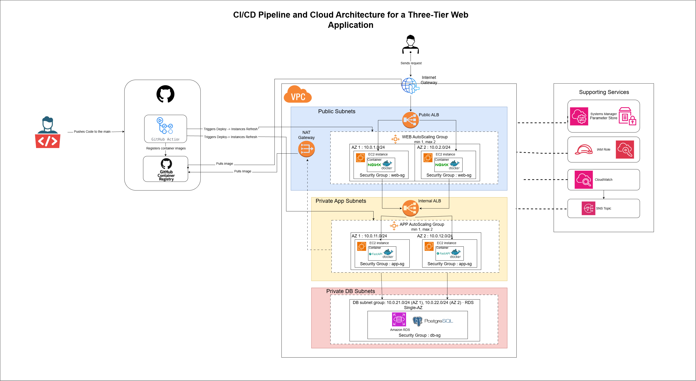
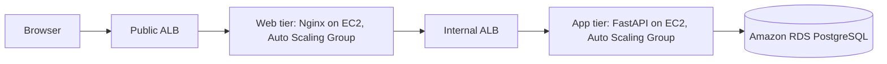

# CloudOps Dashboard: three-tier app on AWS

A three-tier web application that we containerized, deployed on AWS and automated with a CI/CD pipeline.

## What it does

CloudOps is a small dashboard for tracking cloud services (name, environment, owner, status and notes). There are two roles:

- **Admin** can add, update and delete services.
- **Customer** has a read-only view.

## Architecture





| Tier | What runs | Where |
| --- | --- | --- |
| Web | Nginx container (static frontend, proxies `/api` to the app tier) | Public subnets, behind the public ALB |
| Application | FastAPI container on port 8000 | Private app subnets, behind the internal ALB |
| Database | Amazon RDS for PostgreSQL 16 | Private DB subnets, not publicly accessible |

Everything runs in `eu-north-1` (Stockholm) in one VPC (`10.0.0.0/16`) across two Availability Zones. Each tier has its own security group that only accepts traffic from the tier in front of it: `public-alb-sg` → `web-sg` → `internal-alb-sg` → `app-sg` → `db-sg`.

## Tech stack

Python (FastAPI), PostgreSQL, Nginx, Docker, GitHub Actions, GitHub Container Registry (GHCR), and on AWS: VPC, EC2 with Auto Scaling, Application Load Balancers, RDS, Systems Manager (Parameter Store and Session Manager), IAM, CloudWatch and SNS.

## Repository structure

```
.
├── backend/                  FastAPI app, tests, Dockerfile
├── frontend/                 Static site, Dockerfile, nginx.conf.template
├── scripts/                  EC2 user data for the web and app launch templates
├── docs/                     Architecture diagram
├── docker-compose.yml        Local run and CI smoke test
├── .env.example              Variables the app expects (local demo values only)
└── .github/workflows/
    └── ci-cd.yml             Test, build, push and deploy pipeline
```

## Run it locally

You need Docker with Docker Compose.

```bash
cp .env.example .env
docker compose up --build
```

Then open http://localhost:8080. The API docs are at http://localhost:8000/docs. The login details in `.env.example` are for local testing only. On AWS we use different values, stored in Parameter Store.

To run the backend tests without Docker:

```bash
cd backend
python3 -m venv .venv && source .venv/bin/activate
pip install -r requirements.txt
python -m pytest
```

## How the AWS deployment works

- **Instances start from launch templates.** The user data (see `scripts/`) installs Docker, reads its settings and secrets from Parameter Store through the instance's IAM role, logs in to GHCR with a read-only token, pulls the image and starts the container.
- **Nothing sensitive is in the repo.** The database credentials, application secret, user passwords and registry token are all SecureString parameters.
- **The web tier finds the app tier through the internal ALB.** Nginx gets the address from the `API_UPSTREAM` environment variable, so the same image works locally and on AWS.
- **No SSH.** Port 22 is not open anywhere. We use Session Manager when we need a shell.

## CI/CD pipeline

The pipeline in `.github/workflows/ci-cd.yml` runs on every push and pull request to `main`:

1. **Lint, test and audit:** Ruff, pytest with coverage, and pip-audit.
2. **Smoke test:** builds and starts the whole stack with Docker Compose and checks the health endpoints and home page through Nginx.
3. **Build and push:** builds both images and pushes them to GHCR, tagged `latest` and with the commit SHA.
4. **Deploy:** authenticates to AWS using GitHub OIDC (no stored access keys) and starts an Auto Scaling Instance Refresh on the app tier and then the web tier. New instances are launched and checked before the old ones are removed.

Publishing and deployment only run on pushes to `main`.

## Monitoring

Container logs go to CloudWatch Logs (`/cloudops/web` and `/cloudops/app`). Five CloudWatch alarms send email through SNS: unhealthy hosts on each target group, high CPU on the Auto Scaling Group, and high CPU and low free storage on the database. A CloudWatch dashboard shows requests, response times, errors, CPU and database connections.

## Known limitations

- Traffic is HTTP only, because we have no domain or certificate (an ACM certificate and an HTTPS listener would fix this).
- RDS and the NAT Gateway are Single-AZ, so they are single points of failure.
- Both tiers normally run one instance, and scale to a maximum of two.
- Deployments replace instances, so they take a while, and rollback is manual.
- The GHCR token is a long-lived personal access token. Moving the images to ECR would remove the need for it.

## Credits

The application code (backend and frontend) comes from the open-source project [Three-Tier-Cloud-Engineering-Portfolio-Project](https://github.com/Janhvi-Arya/Three-Tier-Cloud-Engineering-Portfolio-Project) by Janhvi-Arya, used with our instructor's permission. See that repository for its licence terms. The Dockerfiles, nginx configuration template, AWS architecture, security design, CI/CD pipeline and monitoring are our own work.
